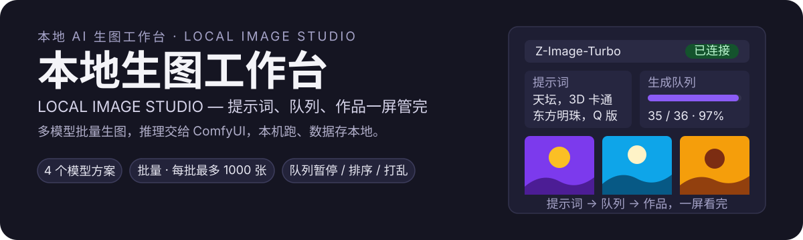
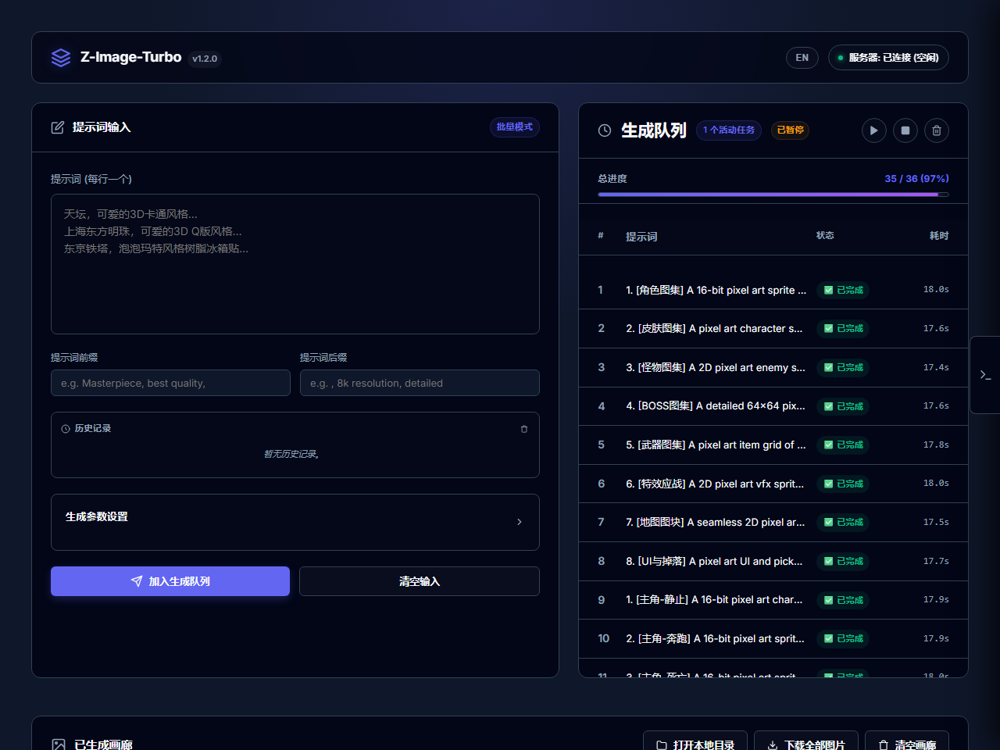

<p align="right"><a href="README.md">中文</a></p>

<p align="center">
  
</p>

<p align="center">
  <a href="https://xiaosang.cc/image-local-llm/">▶ Static Preview</a>
  ·
  <a href="https://holynova.github.io/image_local_llm/">GitHub Pages</a>
  ·
  <a href="https://github.com/holynova/image_local_llm/releases">Releases</a>
  ·
  <a href="https://github.com/holynova/image_local_llm">GitHub Repository</a>
</p>

Local Image Studio （本地生图工作台） is a local multi-model AI image generation workbench: prompts, batch queues, and gallery management in one place, while model download, loading, and inference stay in a separate ComfyUI service. Current version **v1.5.0**; see [CHANGELOG.md](CHANGELOG.md) for release notes. The online preview is a static page — generation only runs locally.

## Screenshot

<p align="center">
  
</p>

## Features

- **Multiple models**: 4 built-in presets (see the table below), with per-model parameter suggestions and aspect-ratio-aware size options.
- **Batch generation**: one prompt per line, 1–100 images each, up to 1000 per batch; prefix/suffix/seed controls.
- **Queue control**: pause, resume, stop, reorder, and shuffle; switching models updates pending tasks without interrupting the running image.
- **Workspace / gallery tabs**: a wide three-column layout with adjustable, saved widths; the latest result is shown in the center.
- **Gallery management**: model info, fullscreen details, download, regenerate, like/dislike with filtering.
- **Progress estimation**: per-image progress is estimated from the same model's historical average time, capped at 99% until done; with no samples it shows indeterminate progress.
- **Local storage**: SQLite stores task and result records; prompt history, ratings, filters, and column widths live in the browser.

## Built-in Models

| Preset | Default size | Steps / CFG | Notes |
|---|---|---|---|
| Z-Image-Turbo | 1024×1024 | 9 / 1 | ComfyUI split-weights workflow |
| SDXL Turbo | 512×512 | 4 / 1 | Fast drafts; English prompts recommended |
| Qwen-Image 2.1 INT8 | 768×768 | 25 / 1 | CPU text encoding and VAE, stability first |
| FLUX.2 klein 4B FP8 | 1024×1024 | 4 / 1 | Distilled version, CPU text encoding and VAE |

The current quantization setup was validated on an RTX 5070 Ti 16GB with 32GB RAM; it is not a minimum-spec guarantee for every machine. Weights, configuration, and measurements are in [COMFYUI_SETUP.md](COMFYUI_SETUP.md), [QWEN21_SETUP.md](QWEN21_SETUP.md), and [FLUX2_SETUP.md](FLUX2_SETUP.md).

## Install & Run

Recommended: native Windows split deployment — ComfyUI + the lightweight workbench.

**1. Prepare ComfyUI** — install the official ComfyUI Portable or Comfy Desktop; an existing ComfyUI can be connected directly. First verify in ComfyUI that your target model generates images normally.

**2. Install the workbench** — install Python 3.11+, download and extract the source, then double-click `install.bat`. The script creates `.venv-comfy` and installs the lightweight client dependencies without touching ComfyUI's Python environment.

**3. Connect and start** — with ComfyUI running on `127.0.0.1:8188`, just double-click `start_server.bat`; for another address, set `COMFYUI_URL` in PowerShell first. Open `http://127.0.0.1:8000` and refresh the model list.

```powershell
$env:COMFYUI_URL = 'http://127.0.0.1:8188'
.\.venv-comfy\Scripts\python.exe -m uvicorn server:app --host 127.0.0.1 --port 8000
```

Note: start only one Uvicorn worker; the current API has no user authentication, so do not expose it directly to the public internet. Models missing weights or nodes are shown as unavailable; a model appearing in the list does not mean it has been downloaded and installed.

## Tech

```text
Browser: HTML / CSS / vanilla JavaScript
    ↓ HTTP (queue, parameters, gallery)
FastAPI + Uvicorn: business API / single-consumer queue
    ├─ SQLite: tasks, workflow snapshots, result records
    ├─ static/outputs: downloaded generated images
    └─ HTTPX + WebSocket → ComfyUI: executes API JSON workflows
                              └─ PyTorch / CUDA / model weights / nodes
```

- Runtime dependencies are in `requirements.txt` (FastAPI, Uvicorn, HTTPX, websockets) — **no PyTorch, Diffusers, CUDA, or model weights**. Node.js is only used for development testing; running the site needs no Node or frontend build.
- Adding a model: verify in ComfyUI → export API-format JSON → drop it in `workflows/` → add the binding in `workflows/registry.json` → restart the workbench and check availability.
- Data locations: `data/studio.sqlite3` (queue and results), `static/outputs/` (local copies of generated images), browser localStorage (prompt history, ratings, layout preferences). Back up the database and output directory before upgrading; don't overwrite data while generating.
