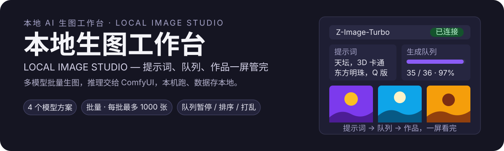
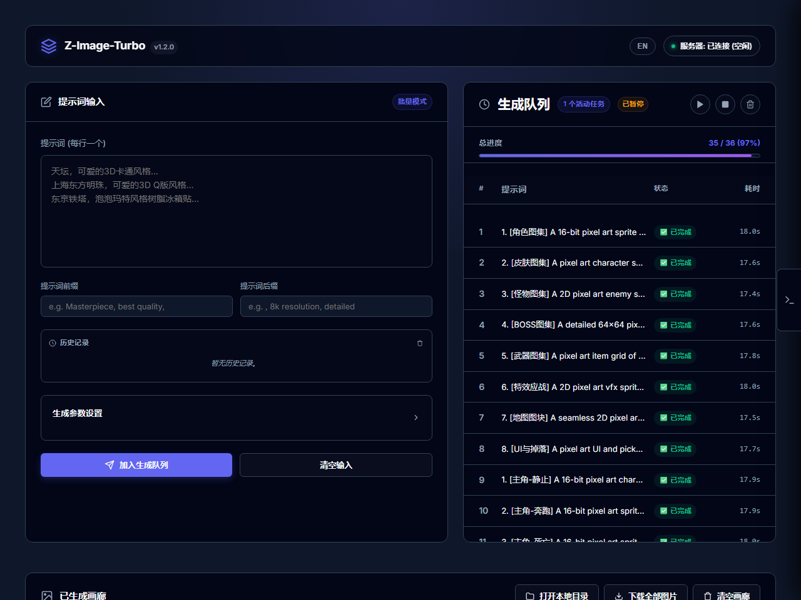

<p align="right"><a href="README.en.md">English</a></p>

<p align="center">
  
</p>

<p align="center">
  <a href="https://xiaosang.cc/image-local-llm/">▶ 静态预览</a>
  ·
  <a href="https://holynova.github.io/image_local_llm/">GitHub Pages</a>
  ·
  <a href="https://github.com/holynova/image_local_llm/releases">下载版本</a>
  ·
  <a href="https://github.com/holynova/image_local_llm">GitHub 仓库</a>
</p>

本地生图工作台（Local Image Studio）是本地多模型 AI 批量生图工作台，专注提示词、任务队列与作品管理；模型下载、加载和推理由独立的 ComfyUI 服务负责。当前版本 **v1.5.0**，更新记录见 [CHANGELOG.md](CHANGELOG.md)。在线预览是静态页面，不提供生图服务——生图要在本机跑。

## 截图

<p align="center">
  
</p>

## 功能

- **多模型**：4 个内置方案（见下表），模型专属参数建议、带宽高比的尺寸选项。
- **批量生成**：批量提示词，每条生成 1–100 张，每批总计最多 1000 张；前缀、后缀、种子设置。
- **队列控制**：暂停、继续、停止、排序、打乱；切换模型同步更新待执行任务，不中断正在生成的图片。
- **工作区 / 作品双 Tab**：宽屏三栏可调宽度并保存布局；中央查看最新结果。
- **作品管理**：模型信息、全屏详情、下载、再生成、点赞 / 点踩与筛选。
- **进度估算**：单图进度按相同模型的历史平均耗时估算，完成前最多 99%；没有样本时显示不确定进度。
- **本地存储**：SQLite 保存任务与结果记录；提示词历史、评价、筛选与栏宽存在浏览器本地。

## 内置模型方案

| 方案 | 默认尺寸 | 步数 / CFG | 说明 |
|---|---|---|---|
| Z-Image-Turbo | 1024×1024 | 9 / 1 | ComfyUI 分离权重工作流 |
| SDXL Turbo | 512×512 | 4 / 1 | 快速草稿，建议英文提示词 |
| Qwen-Image 2.1 INT8 | 768×768 | 25 / 1 | CPU 文本编码与 VAE，优先稳定性 |
| FLUX.2 klein 4B FP8 | 1024×1024 | 4 / 1 | 蒸馏版，CPU 文本编码与 VAE |

当前量化配置在 RTX 5070 Ti 16GB、32GB RAM 上验证过；不是所有电脑的最低配置保证。权重、配置与实测见 [COMFYUI_SETUP.md](COMFYUI_SETUP.md)、[QWEN21_SETUP.md](QWEN21_SETUP.md)、[FLUX2_SETUP.md](FLUX2_SETUP.md)。

## 安装与启动

推荐 Windows 原生分离部署：ComfyUI + 轻量工作台。

**1. 准备 ComfyUI** — 安装官方 ComfyUI Portable 或 Comfy Desktop；已有 ComfyUI 可直接接入。先在 ComfyUI 里验证目标模型能正常生成图片。

**2. 安装工作台** — 安装 Python 3.11+，下载源码并解压，双击 `install.bat`。脚本创建 `.venv-comfy` 并安装轻量客户端依赖，不修改 ComfyUI 的 Python 环境。

**3. 接入并启动** — ComfyUI 运行在 `127.0.0.1:8188` 时，直接双击 `start_server.bat`；其他地址在 PowerShell 中设置 `COMFYUI_URL` 后启动。打开 `http://127.0.0.1:8000`，刷新模型列表。

```powershell
$env:COMFYUI_URL = 'http://127.0.0.1:8188'
.\.venv-comfy\Scripts\python.exe -m uvicorn server:app --host 127.0.0.1 --port 8000
```

注意：只能启动一个 Uvicorn worker；当前 API 没有用户认证，不要直接暴露到公网。缺少权重或节点的模型会提示不可用；列表里出现模型不代表已下载安装。

## 技术

```text
浏览器：HTML / CSS / 原生 JavaScript
    ↓ HTTP（队列、参数、图库）
FastAPI + Uvicorn：业务 API / 单消费者队列
    ├─ SQLite：任务、工作流快照、结果记录
    ├─ static/outputs：下载的生成图片
    └─ HTTPX + WebSocket → ComfyUI：执行 API JSON 工作流
                              └─ PyTorch / CUDA / 模型权重 / 节点
```

- 工作台运行时依赖见 `requirements.txt`（FastAPI、Uvicorn、HTTPX、websockets），**不包含 PyTorch、Diffusers、CUDA 或模型权重**。Node.js 仅用于开发测试，运行网站不需要 Node 或前端构建。
- 新增模型：先在 ComfyUI 验证 → 导出 API 格式 JSON → 放入 `workflows/` → 在 `workflows/registry.json` 添加绑定 → 重启工作台并检查可用性。
- 数据位置：`data/studio.sqlite3`（队列与结果）、`static/outputs/`（生成图片本地副本）、浏览器 localStorage（提示词历史、评价、布局偏好）。升级前备份数据库与输出目录；不要在生成时覆盖数据。
