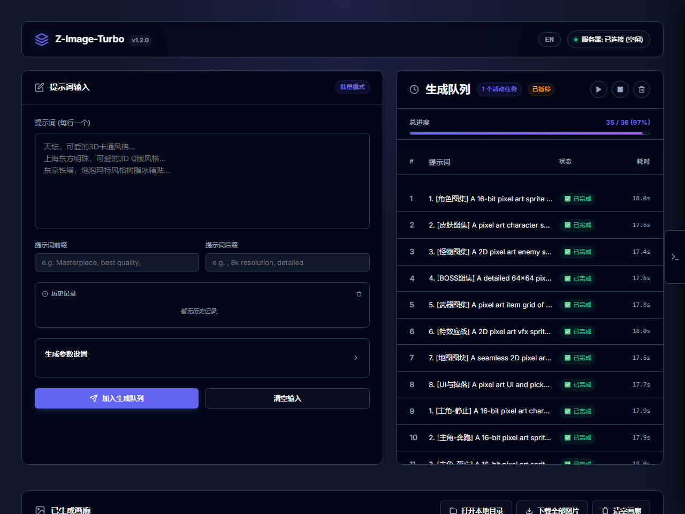

# Local Image Studio

当前版本：**v1.4.0**。更新说明见 [CHANGELOG.md](CHANGELOG.md)。

> ComfyUI 后端开发版：本工作台已改为通过 API 调用 ComfyUI。新安装与使用方式见 [COMFYUI_SETUP.md](COMFYUI_SETUP.md)，旧 Diffusers 安装步骤仅适用于之前的版本。

本地多模型 AI 生图工作台，基于 FastAPI 与 ComfyUI API，支持模型切换、批量提示词队列、暂停/继续/停止、历史记录、模型参数建议和生成图片画廊。适合在消费级显卡上进行本地批量出图。

- GitHub Repo: [holynova/image_local_llm](https://github.com/holynova/image_local_llm)
- GitHub Pages: [https://holynova.github.io/image_local_llm/](https://holynova.github.io/image_local_llm/)

## v1.4.0 快速开始

1. 运行 `install.bat` 创建轻量客户端环境 `.venv-comfy`（工作台不加载 PyTorch）。
2. 按照 [COMFYUI_SETUP.md](COMFYUI_SETUP.md) 配置并启动 ComfyUI。
3. 运行对应的 `start_studio_local.bat` 或 `start_studio_qwen21.bat`；接入已有 8188 端口的 ComfyUI 可运行 `start_server.bat`。
4. 打开 http://127.0.0.1:8000 ，刷新模型列表并开始创作。

## 旧版安装说明（仅适用于 v1.3.0 及之前）

### 1. 一键配置环境与依赖
双击运行项目根目录下的 [install.bat](file:///g:/code/image_local_llm/install.bat) 脚本。它将自动：
- 创建 Python 虚拟环境（`venv`）
- 安装 CUDA 12.8 兼容的 PyTorch 运行库
- 安装 `diffusers`、`transformers`、`fastapi` 等依赖
- 应用本地兼容性补丁

### 2. 启动服务
环境配置完成后，双击运行 [start_server.bat](file:///g:/code/image_local_llm/start_server.bat)。它将在本地启动 FastAPI 服务并自动加载 `Z-Image-Turbo` 模型：
- 运行地址：`http://127.0.0.1:8000`

### 3. 访问网页
在浏览器中打开 **[http://127.0.0.1:8000](http://127.0.0.1:8000)** 即可开始使用本地 AI 批量生图工作台。生成的图片将保存在 [static/outputs/](file:///g:/code/image_local_llm/static) 目录中。
